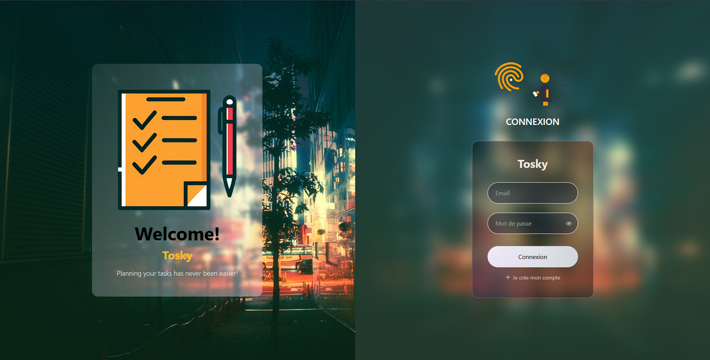
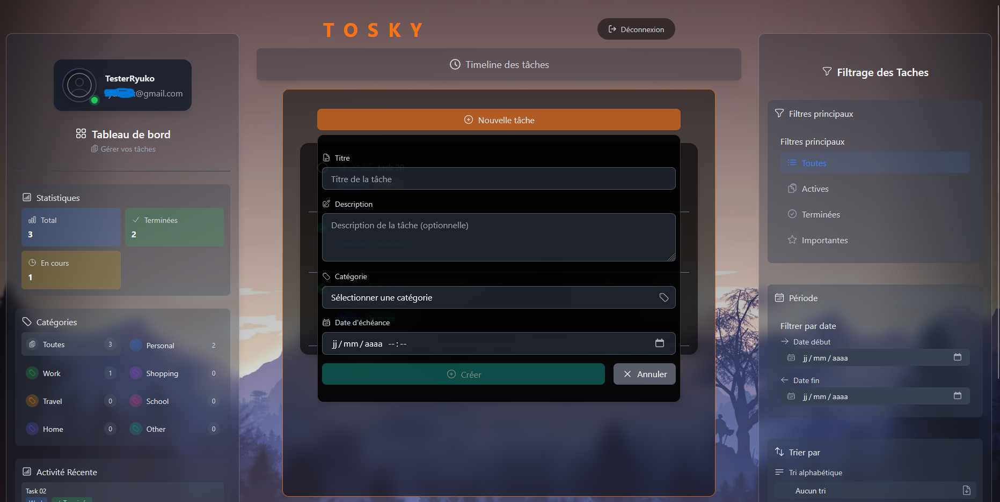
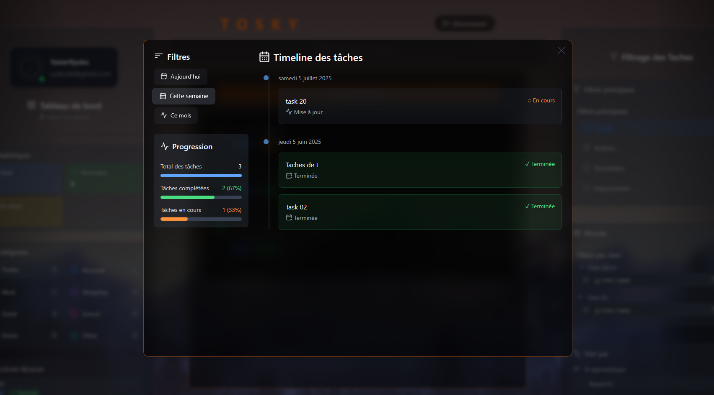
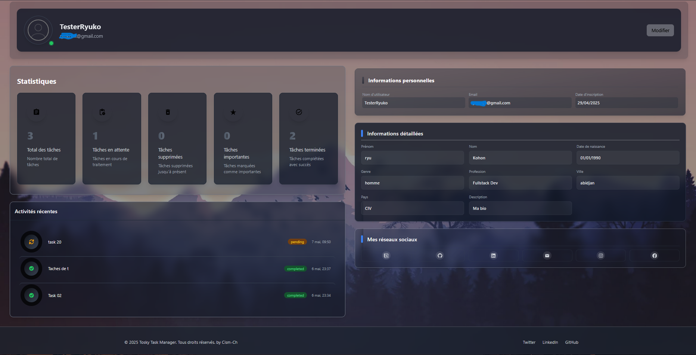
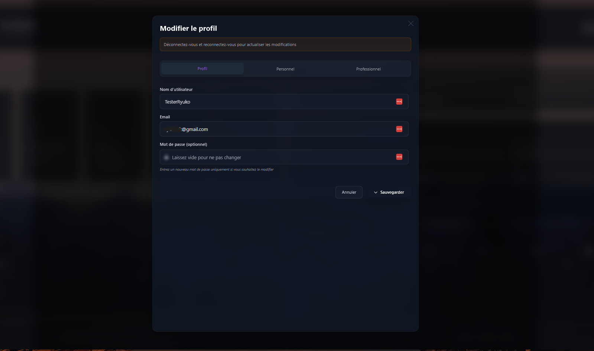

# 📋 TaskManager MERN

> Application moderne de gestion de tâches construite avec la stack MERN (MongoDB, Express.js, React, Node.js)

## ✨ Caractéristiques Principales

- 🔐 Authentification complète avec validation par email
- 📱 Interface responsive et moderne avec mode sombre/clair
- 🎯 Gestion avancée des tâches avec catégorisation
- 📊 Filtrage et tri sophistiqués
- ⏱️ Timeline interactive des tâches
- 👤 Profils utilisateurs personnalisables

## 🚀 Technologies

### Frontend


### Backend


## 📋 Prérequis

- **Node.js 20.x ou supérieur**
  - Nécessaire pour exécuter le backend et le frontend
  - La version LTS est recommandée pour une meilleure stabilité
  
- **MongoDB 6.x ou supérieur**
  - Base de données NoSQL pour stocker les données de l'application
  - Installation locale ou utilisation d'un service cloud (MongoDB Atlas)
  - Création d'une base de données dédiée pour le projet
  
- **pnpm (recommandé) ou npm**
  - Gestionnaire de paquets pour installer les dépendances
  - pnpm offre une meilleure performance et gestion de l'espace disque
  - Installation : `npm install -g pnpm`
  
- **Compte email pour les notifications**
  - Nécessaire pour l'envoi des emails de validation et notifications
  - Configuration SMTP requise (Gmail, Outlook, ou autre service SMTP)

## 🛠️ Installation

### Configuration du Backend

1. Cloner le dépôt :
```bash
git clone [url-du-repo]
cd Final_Taskmanager_MERN
```

2. Installer les dépendances du backend :
```bash
cd Taskmanager_Backend
pnpm install
```

3. Configurer les variables d'environnement :
```bash
cp .env.example .env
```

Variables d'environnement requises pour le backend :
```env
PORT=5000
MONGODB_URI=mongodb://localhost:27017/taskmanager
JWT_SECRET=votre_secret_jwt
EMAIL_HOST=smtp.gmail.com
EMAIL_PORT=587
EMAIL_USER=votre_email@gmail.com
EMAIL_PASSWORD=votre_mot_de_passe_app
```

4. Démarrer le serveur :
```bash
pnpm run start
```

### Configuration du Frontend

1. Installer les dépendances :
```bash
cd ../Taskmanager_Frontend
pnpm install
```

2. Configurer les variables d'environnement :
```bash
cp .env.example .env
```

Variables d'environnement requises pour le frontend :
```env
VITE_API_URL=http://localhost:5000/api
VITE_APP_NAME=TaskManager
VITE_APP_VERSION=1.0.0
```

3. Lancer l'application :
```bash
pnpm run dev
```

## 🏗️ Structure du Projet

### Frontend
```
src/
├── components/     # Composants réutilisables
├── pages/         # Pages de l'application
├── contexts/      # Contextes React
├── hooks/         # Custom hooks
├── redux/         # Store et slices Redux
├── services/      # Services API
└── utils/         # Utilitaires
```

### Backend
```
├── controllers/   # Logique métier
├── routes/       # Définition des routes
├── models/       # Modèles Mongoose
├── middlewares/  # Middlewares Express
├── services/     # Services métier
└── utilitaire/   # Fonctions utilitaires
```

## 🔥 Fonctionnalités Détaillées

### Gestion des Utilisateurs
- **Inscription avec validation email**
  - Formulaire d'inscription complet
  - Envoi d'email de confirmation avec lien de validation
  - Protection contre les inscriptions multiples
  
- **Authentification JWT sécurisée**
  - Tokens JWT pour la gestion des sessions
  - Refresh tokens pour une connexion persistante
  - Déconnexion automatique après expiration
  
- **Profils personnalisables avec avatar**
  - Upload d'images pour l'avatar
  - Modification des informations personnelles
  - Prévisualisation des modifications
  
- **Statistiques d'activité**
  - Nombre de tâches créées/complétées
  - Graphiques d'activité journalière
  - Historique des modifications

### Gestion des Tâches
- **CRUD complet des tâches**
  - Création intuitive avec formulaire détaillé
  - Modification en temps réel
  - Suppression avec confirmation
  - Marquage comme complété/incomplet
  
- **Catégorisation personnalisée**
  - Création de catégories personnalisées
  - Attribution de couleurs aux catégories
  - Filtrage par catégorie
  
- **Filtrage multi-critères**
  - Par statut (complété/incomplet)
  - Par date de création/échéance
  - Par priorité
  - Par catégorie
  
- **Tri avancé**
  - Par date (croissant/décroissant)
  - Par priorité
  - Par statut
  - Par ordre alphabétique
  
- **Timeline interactive**
  - Vue chronologique des tâches
  - Indicateurs visuels de progression
  - Navigation temporelle intuitive

### Interface Utilisateur
- Design responsive
- Mode sombre/clair
- Composants réutilisables
- Notifications toast
- Modales interactives

## 📸 Captures d'écran

### Interface de connexion


### Création de tâche


### Timeline des tâches


### Profil utilisateur


### Modification de profil


## 🔧 Scripts Disponibles

### Backend
- `pnpm run start` : Démarre le serveur
- `pnpm run test` : Lance les tests

### Frontend
- `pnpm run dev` : Lance le serveur de développement
- `pnpm build` : Crée la version de production
- `pnpm preview` : Prévisualise la version de production